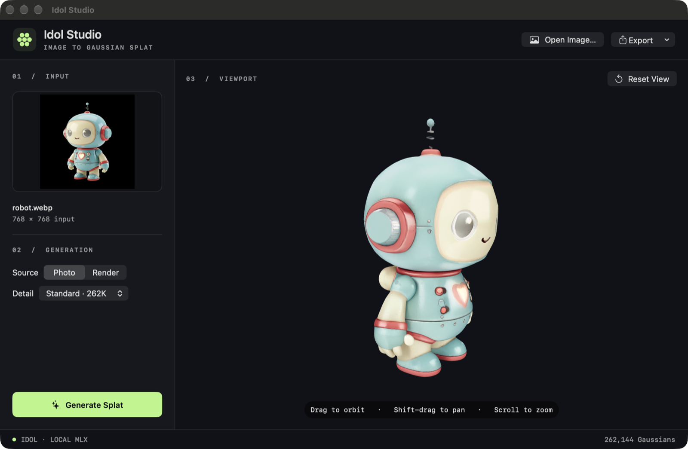

# Idol Studio

## [⬇ Download for Mac](https://github.com/abradburne/idol-studio/releases/latest/download/Idol-Studio.dmg)

Apple Silicon · macOS 26.2+ · Signed and notarized

<!-- Attach the signed, notarized DMG as Idol-Studio.dmg before publishing each release. -->

Turn a single image into a 3D asset on your Mac. Generate a Gaussian splat with IDOL or a textured mesh with Hunyuan3D 2.1, then inspect and export the result. Everything runs locally.



## Getting started

Requires **Apple Silicon** and **macOS 26.2 or later**.

1. Open the signed DMG and drag **Idol Studio** into **Applications**.
2. Choose Splat or Mesh and download its model. IDOL uses 3.57 GB and Hunyuan3D uses 8.36 GB. You can choose where to store it or select an existing model folder. Manage it later in **Settings (⌘,)**.
3. Drop in an image or paste one with **⌘V**, then click **Generate Splat** or **Generate Mesh**. Drag to orbit, Shift-drag to pan, and scroll to zoom.
4. Use **Export** to save a splat as **PLY** or **GLB**, or a textured mesh as **GLB**.

## Build from source

With Xcode installed, run these commands from the project folder.

```sh
./scripts/setup.sh
open ".build/Idol Studio.app"
```

## Batch queue and MCP

Open **Queue**, choose an output format, and add images or a folder. Studio keeps a copy of each input and runs one job at a time. The queue shows progress, lets you cancel or retry jobs, and opens finished files in Finder. Install the IDOL or Hunyuan3D model in Settings before generating its output.

To connect a local MCP client, configure it to launch the app executable with `--mcp`. Use the absolute path to your installed or built copy.

```json
{
  "command": "/Applications/Idol Studio.app/Contents/MacOS/IdolStudio",
  "args": ["--mcp"]
}
```

- `generate_3d` takes an absolute `image_path` or a list of `image_paths` and returns job IDs. Choose `splat_ply`, `splat_glb`, or `mesh_glb`.
- `job_status` takes a `job_id` and returns progress or the finished file’s local path.
- `cancel_job` takes a `job_id` and stops a queued or running job.

The app and MCP clients share the same queue. The worker can continue after a client disconnects.

Powered by [IDOL](https://github.com/speridlabs/idol-sdk) and [MLX-Serve](https://github.com/ddalcu/mlx-serve). The robot image is from the [IDOL demo gallery](https://github.com/speridlabs/idol-sdk/blob/main/demo/examples/fig-robot-cute.webp).
